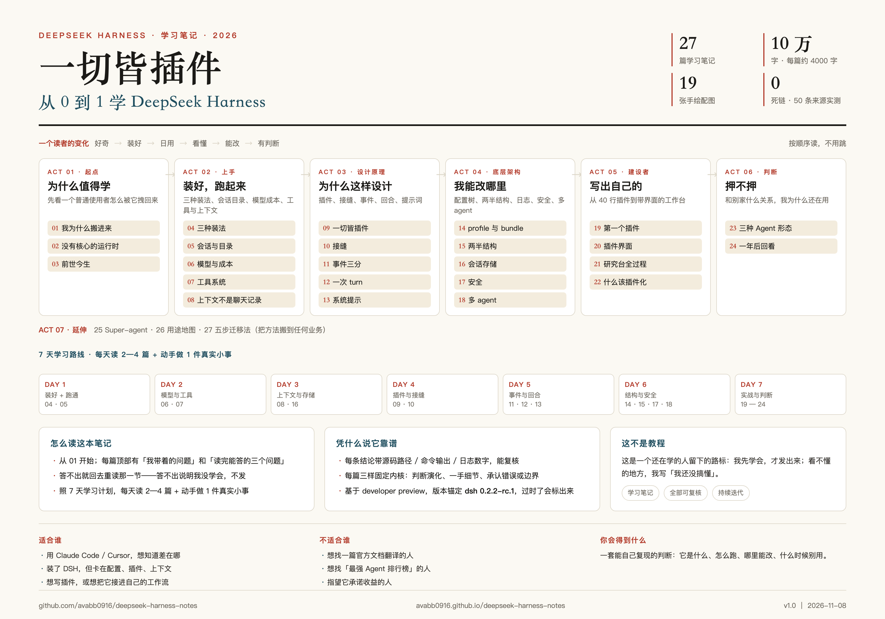

# 一切皆插件 · DeepSeek Harness 学习笔记

> **这本书回答三个问题：DeepSeek Harness 是什么？它能帮你做什么？怎么把它用到你自己的业务里？**
> 27 篇 ｜ 第一版以「网站出海」为完整案例 ｜ 基于 `dsh 0.2.2-rc.1`（2026-11-04）｜ 更新于 2026-11-08



## 你可能是谁

- **刚听说 DeepSeek / ChatGPT 的人**：想知道「Harness 又是什么」，跟聊天工具有什么不一样。
- **公司里的岗位**：市场、运营、销售、研发——手里有一堆重复流程，想知道能不能交给 AI 团队。
- **个体**：带孩子的家长、一人公司、自由职业者——想把一件事从头到尾跑起来，但没有团队。

不管你是谁，你真正想问的其实是同一句：**它能帮我做什么？我能把它套到我的业务里吗？**

## 这本书回答什么

1. **它是什么**：一个「一切皆插件」的 Agent 运行时，不是聊天工具，也不是 IDE（01—03）。
2. **它能帮你做什么**：内容生产、知识库、Coding、Vibe coding、多 agent、产品调研、常驻 Agent（26）。
3. **怎么用到你的业务里**：选一条线 → 拆七段 → 拆原子 → 配角色 → 设闸门（27）。

## 第一版的范围（重要）

**第一版只做「网站出海」这一个垂直案例，不把所有行业都写一遍。**

- 为什么先做它：流程最全（选词/竞品/内容/建站/分发/数据）、反馈最快（收录、排名、流量）、一个人就能启动。
- 案例会写成一个 **7 天闭环**：46 个原子、8 个角色，前 7 天只跑 10 个原子，最后落到一个能打开的站。
- **其他方向是后续版本的事**：市场、销售、研发、家长辅导、一人公司……方法不变，换的是业务名词。等这一版跑通、电子书有了影响力，再逐个扩。

所以你现在读到的不是「全行业大全」，是**一个样板间 + 一套可搬走的水电走法**。

## 两部分怎么读

- **学原理（01—24）**：DSH 是什么、怎么跑、为什么这样设计、我能改哪里。
- **搬方法（25—27）**：官方 Super-agent 设计、七种用法、五步迁移法；然后跟着网站出海案例（28 起）走一遍。

## 适合谁 / 不适合谁

适合：想搞懂 DSH 的人、想把重复流程交给 agent 的人、想用一个人跑一条业务线的人。

不适合：想找官方文档翻译的人、想找「最强 Agent 排行榜」的人、指望它承诺收益的人。

## 在线阅读

在线阅读：**https://avabb0916.github.io/deepseek-harness-notes/**

本地看：直接双击 `docs/index.html`（全部自包含，离线可读）。

## 内容

| 部分 | 篇目 |
|---|---|
| 起点 | 01 我为什么搬进来 · 02 没有核心的运行时 · 03 前世今生 |
| 上手 | 04 三种装法 · 05 会话与目录 · 06 模型与成本 · 07 工具系统 · 08 上下文 |
| 设计原理 | 09 一切皆插件 · 10 接缝 · 11 事件三分 · 12 一次 turn · 13 系统提示 |
| 底层架构 | 14 profile 与 bundle · 15 两半结构 · 16 会话存储 · 17 安全 · 18 多 agent |
| 建设者 | 19 写第一个插件 · 20 插件界面 · 21 研究台全过程 · 22 什么该插件化 |
| 判断 | 23 三种 Agent 形态 · 24 一年后回看 |
| 延伸 | 25 官方 Super-agent 设计（2026-10-31） · 26 我能用它做什么（七种用法） |
| 方法 | 27 五步迁移法：把这套方法搬到任何业务 |
| 案例（在写） | 28 7 天闭环 · 29 原子落地 · 30 产能账 · 31 失败复盘 · 32 第二站复用 · 33 换业务演练 |
| 规划 | 34 从原子到插件 · 35 OPT 成熟度 90 天 |

另有 [7 天学习 + 14 天发布计划](docs/plan.html) 与 19 张手绘配图（`docs/images/`）。

## 部署到 GitHub Pages

仓库已部署到 GitHub Pages（`main` 分支 `/docs`）。要再推一次：

```bash
cd dsh-book
git add -A && git commit -m "更新笔记" && git push
```

如需从头重建仓库：

```bash
# 在 GitHub 新建一个公开仓库（不要勾选初始化 README）
git init
git add .
git commit -m "DSH 学习笔记 24 篇 v1.0"
git branch -M main
git remote add origin https://github.com/<你的用户名>/<仓库名>.git
git push -u origin main
```

然后仓库 **Settings → Pages → Build and deployment → Source: Deploy from a branch → Branch: `main` / 文件夹: `/docs` → Save**。
一两分钟后 `https://<用户名>.github.io/<仓库名>/` 就能打开。

## 重新构建

```bash
python3 build.py
```

它会从 `../dsh-series/03-文章/` 重新生成 `docs/`（24 章 + 首页 + 学习计划页 + 配图）。

## 目录

```
dsh-book/
├── README.md
├── build.py            # 构建脚本（读取 dsh-series 的 md → docs/）
└── docs/               # GitHub Pages 站点（已构建）
    ├── index.html      # 封面 + 目录 + 配图墙
    ├── plan.html       # 7 天学习 + 14 天发布
    ├── ch01.html … ch24.html
    ├── images/         # 19 张 PNG
    └── .nojekyll
```

## 说明

- 基于 **developer preview**：官方明确会有破坏性变更；文中所有结论都标了版本与时间。
- 非官方资料；引用请注明出处。发现错误欢迎提 Issue。
- 文字与配图：个人学习笔记，转载注明「大鱼出海 · 一切皆插件」即可。
